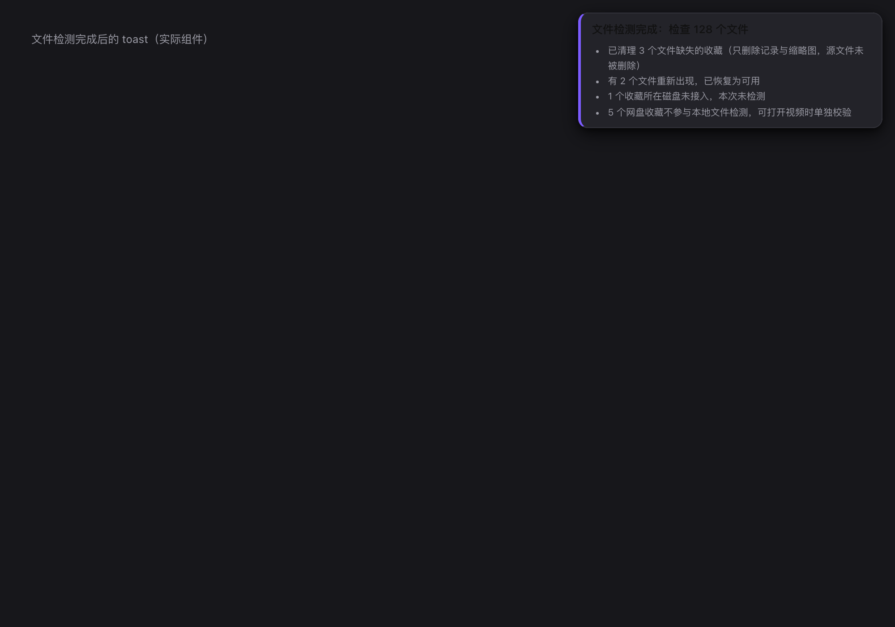
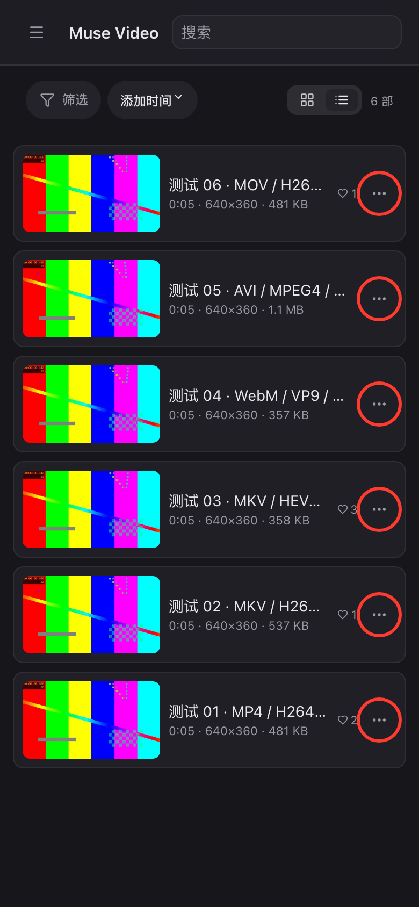
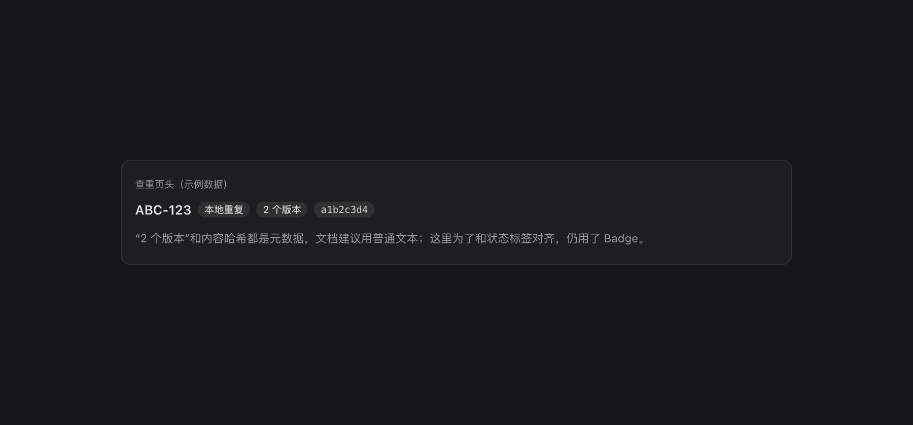

# Astryx 使用现状与文档建议对照

> 基线：`@astryxdesign/core` **0.7.15**，以包内 `src/<Component>/<Component>.doc.mjs` 的 `props`、`usage.bestPractices` 与 `anatomy` 为准。
>
> 复核日期：2026-11-16。逐组件核对了业务层实际调用，而不是只看 import。

## 1. 结论

Phase 1–8 之后，业务层已经没有“自己画按钮、自己接对话框焦点、自己写 tooltip”的组件级替代品。本轮又修掉了 10 类“组件是 Astryx、用法仍是自绘范式”的问题。

目前还有 **5 类刻意保留的产品取舍**。它们不是 API 用错，而是换成文档推荐方案会改变交互或性能模型，因此先记录、不强行改。

## 2. 已修复的偏差

| 组件 | 原现状 | 文档建议 | 现在 |
|---|---|---|---|
| `Button` | 图标作为 `children` 传给 `Button` | 图标走 `icon` 插槽；纯图标用 `IconButton` | 所有业务按钮图标改走 `icon`；侧栏/列表/工具栏的间距问题一并消失 |
| `IconButton` | 只有 `label`，没有 hover 提示 | 必须给 `tooltip`，`label` 只给读屏 | 所有 `IconButton` 都补了 `tooltip` |
| `Button` | 用原生 `title` 当提示 | 用 Astryx `tooltip` | `ui/button.tsx` 把 `title` 映射为 `tooltip`，不再输出原生属性 |
| `Dialog` | 自绘 `<h2>` 标题 + `Button` 包 `<X>` 关闭 + 手接 `aria-labelledby` | 用 `DialogHeader`：标题聚焦、命名、关闭按钮都由它负责 | 全部改用 Astryx `DialogHeader`；无标题灯箱用 `DialogCloseButton` |
| `Dialog` | 表单对话框没有 `purpose` | 有输入的对话框用 `purpose="form"`，防止误点遮罩丢输入 | 添加视频、编辑信息、网盘连接、分组命名等已设置 |
| 确认框 | 普通 `Dialog` + 两个按钮 | 破坏性/不可逆操作使用 `AlertDialog` | `ConfirmDialog` 改 `AlertDialog`；取消是初始焦点，遮罩不可关 |
| `BottomSheet` | 高度写 `"auto"` / `"85dvh"` | 用 `hug` / `capped` / `tall` | 筛选、播放器、操作、编辑分别使用语义高度 |
| `Drawer` | 自绘品牌头 + 关闭按钮 | `DrawerHeader` 提供标题、副标题、关闭 | 移动抽屉改用 `DrawerHeader` |
| `TextInput` / `Field` | 用 `Field` 包 `TextInput` | `TextInput` 已有 Field 壳，不能再包；直接传 `label` | 删除 Settings 的 `Field` 包装，`Input` 支持可见 `label` |
| `Toolbar` | 子按钮各自设 `size="sm"` | `size` 设在 Toolbar 上一次级联 | Toolbar 统一 `size`；`Button` 默认不再强写 `md`，可以继承上下文 |
| `Button` + `aria-pressed` | 硬盘“全部”用普通 Button 当开关 | 持久开关用 `ToggleButton` | “全部”改 `ToggleButton`；Cookie 显示/隐藏是瞬时动作，去掉 `aria-pressed` |

相关提交：`f902590`、`516a684`、`56f706d`。

## 3. 仍然保留的取舍

### 3.1 Toast 放多行详情

**现状**

- `frontend/src/ui/toast.tsx:66` 用 `renderContent` 画自定义卡片
- 同文件 `:87` 渲染 `details: string[]`
- `frontend/src/components/FileScanButton.tsx:139` 的 `summarize()` 最多生成 5 行检测结果
- `frontend/src/pages/Library.tsx` 通过 `pushToast` 把它送进 toast，并给 6 秒 TTL

**文档建议**

- Toast 只放“几分钟内能读完的一两句话”
- 长内容、需要逐条阅读的内容用 `Banner`
- 需要用户确认的阻塞性错误不要用 toast

**为什么没改**

文件检测结果需要保留“清理了几个、恢复了几个、几个离线、几个网盘跳过”这类明细。改成 Banner 需要在 Library 增加一个常驻报告区，属于新的界面区域，不只是替换组件。

**建议方案**

在 Library 工具栏下方增加可关闭的 `Banner`（`status="info"`，`collapsible` 承载明细），toast 只保留“检测完成”一句话。

### 3.2 可点击的 ListItem 内嵌按钮

**现状**

- 移动列表：`frontend/src/mobile/components/VideoGrid.tsx:204` 的 `endContent` 放“更多” `IconButton`
- 桌面列表：`frontend/src/components/VideoList.tsx:107` 的 `endContent` 放点赞 `IconButton`
- 回收站：`frontend/src/components/TrashView.tsx:287` 在行尾放“恢复 / 彻底删除”

**文档建议**

`List` 文档明确说不要在可交互 list item 里再放交互元素，否则会形成嵌套点击目标。

**为什么没改**

整行点击打开视频是列表的主交互；点赞、更多、恢复又是高频行级动作。当前用 `stopPropagation` 保证不会误触，但 DOM 结构上仍是嵌套按钮。

**建议方案**

- 列表行只保留一个行尾“更多”菜单，把点赞/恢复/删除收进菜单
- 或者把行改成“非交互容器 + 标题链接 + 行尾动作”

这会改变列表的快捷操作路径，需要产品确认。

### 3.3 Badge 承载元数据

**现状**

- `frontend/src/components/VideoCard.tsx:112`：卡片右下角时长 `0:05` 用 `Badge`
- `frontend/src/components/DuplicateView.tsx:183`：`2 个版本` 用 `Badge`
- `frontend/src/components/ContentDuplicateView.tsx:174`：内容哈希前 8 位用 `Badge`

**文档建议**

Badge 只用于状态或分类；时长、数量、哈希、日期属于元数据，应该用普通文本。语义状态色（success/warning/error）也不该用于分类。

**为什么没改**

这些值在卡片/页头里和状态标签排在同一行。改成纯文本会失去与“文件缺失 / 网盘离线 / 已备份”这些真状态标签的视觉分层，卡片底部也会多出一段普通文字。

**建议方案**

- 时长、版本数、哈希改成 `text-xs text-[var(--muted)]` 的普通文本
- 只保留“文件缺失 / 磁盘未接入 / 网盘离线”等真正需要用户注意的状态 Badge

第二张图是查重页头的真实标签样式，用示例数据渲染（测试库当前没有重复组）。

### 3.4 导航行仍然用 Button

**现状**

- 移动抽屉：`frontend/src/ui/drawer.tsx:57` 的 `DrawerRow`
- 桌面侧栏：`frontend/src/components/Sidebar.tsx:66` 的 `NavRow`
- 工作区标签：`frontend/src/components/WorkspaceTabs.tsx:154`

**文档建议**

- 导航用链接或 `SideNav` / `NavItem`
- 页内视图切换用 `TabList`，不要用 `Button` 做导航

**为什么没改**

- 侧栏行是原生 HTML5 拖拽的宿主：分组排序、嵌套、投放视频都挂在这些行上
- `WorkspaceTabs` 有“分组容器 + 标签内关闭按钮”，`TabList` 的关闭按钮会形成嵌套 button
- 这些不是“画一个导航按钮”，而是带业务状态机的行

**建议方案**

保留外层业务状态机，只把每行的可点击表面换成 `SideNavItem`/`Tab` 的样式与语义；需要先验证拖拽事件、关闭按钮嵌套和键盘导航不受影响。这是五项里改动最大的一项。

### 3.5 Grid 用固定列数 + 手写模板

**现状**

- 桌面：`frontend/src/components/VideoGrid.tsx:58` 把 JS 算出的列数传给 `Grid`，并手写 `gridTemplateColumns`、`columnGap`、`rowGap`
- 移动：`frontend/src/mobile/components/VideoGrid.tsx:131` 同样传数字列数

**文档建议**

- 用 `columns={{minWidth, max}}` 让 Grid 自己重排
- 不要手写 CSS grid

**为什么没改**

虚拟滚动（`useVirtualRows`）按“当前列数 × 行高”计算窗口和 `offsetTop`。如果让 Grid 自己按容器宽度重排，React 渲染的列数可能和虚拟窗口的数学短暂不一致，出现空白行或跳动。

**建议方案**

保留数字列数，但把 `gridTemplateColumns` 收进 `Grid` 的 `xstyle`/CSS 变量，减少内联样式；如果将来 Astryx 暴露列数变化的回调，再切换到响应式 `{minWidth, max}`。

## 4. 其余组件的复核结果

以下组件未发现 API 误用或与文档冲突的用法：

`AlertDialog`、`AspectRatio`、`Avatar`、`Banner`、`CheckboxInput`、`ClickableCard`、`Divider`、`EmptyState`、`HoverCard`、`List`（结构本身）、`MetadataList`、`ProgressBar`、`Section`、`SegmentedControl`、`Selector`、`Skeleton`、`Slider`、`Spinner`、`TextArea`、`ToggleButton`。

两点说明：

- `Slider` 的 `label` 是隐藏的，但仍有可访问名称；卡片大小没有数值气泡，这是有意的紧凑工具栏设计。
- `DropdownMenu` 的 `MenuSurface` 用 1×1 隐藏触发器保留“在鼠标坐标打开”的能力；菜单项本身是 Astryx 组件。

## 5. 验证

- `npx tsc --noEmit`
- `npm run lint`（裸 `<button>` 2/2，裸表单控件 0/0）
- `npm run build`、`npm run build:mobile`
- `go test ./...`
- `wails build --clean --platform darwin/arm64`，覆盖安装 `/Applications/Muse.app`
- 无头 Chrome 实拍：Toast、移动列表、移动网格、移动抽屉、Settings 表单、添加视频对话框、AlertDialog、图片灯箱

## 6. 建议的后续顺序

1. **Toast → Banner**：收益最大，改动局限在 Library 与 `FileScanButton` 的返回结构。
2. **Badge 元数据 → 普通文本**：纯展示改动，风险低。
3. **ListItem 行内动作收敛**：需要产品确认交互。
4. **导航行换 `SideNav`/`TabList`**：牵动拖拽与标签关闭，建议单独排期。
5. **Grid 响应式列**：等虚拟滚动或 Astryx 提供列数回调后再做，暂不冒险。
