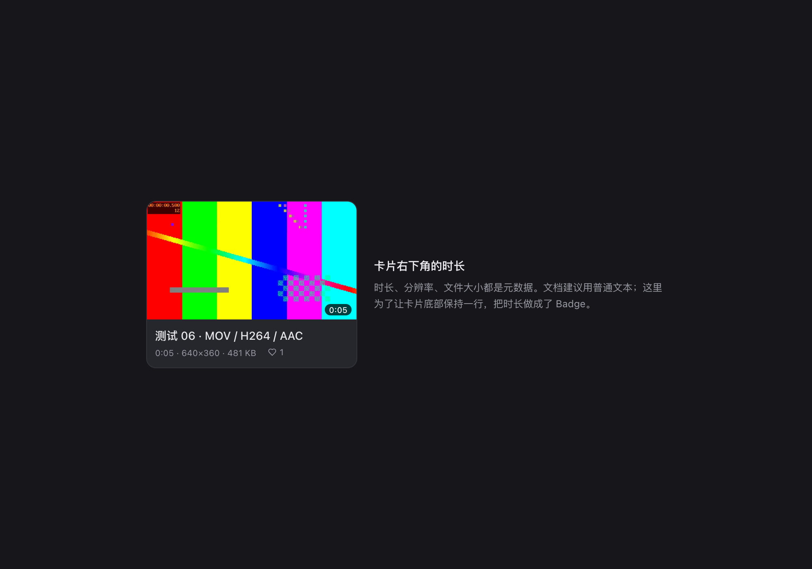
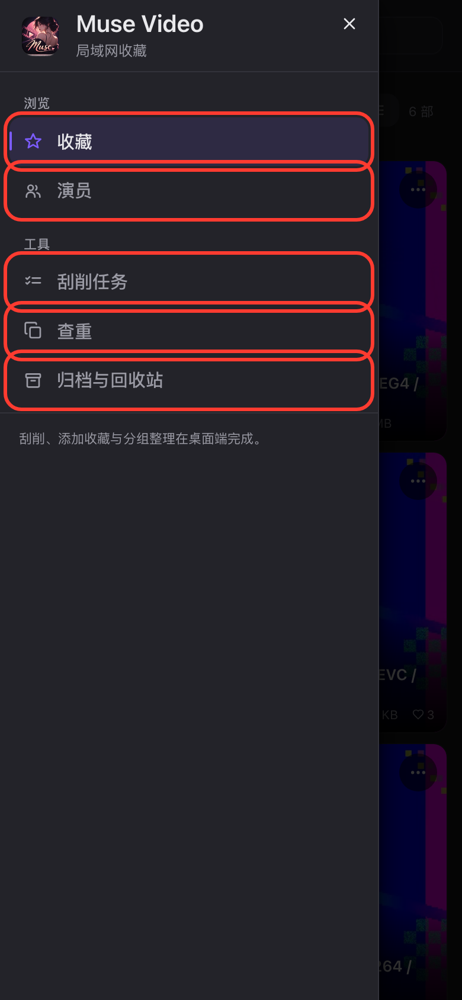
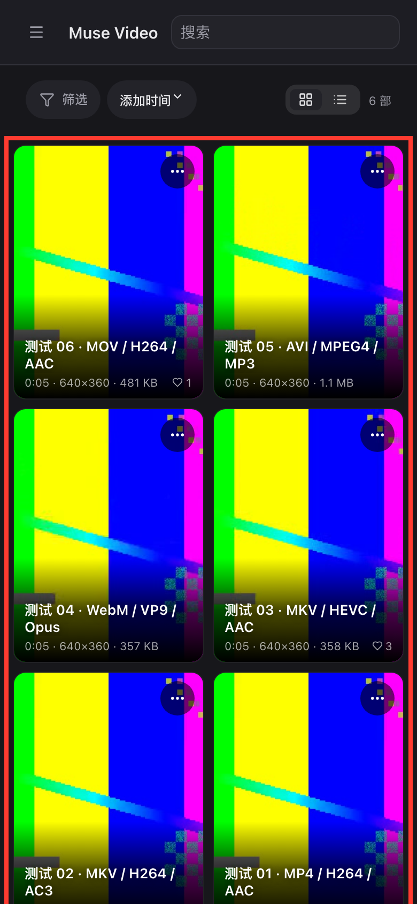

# Astryx 使用现状与文档建议对照

> 基线：`@astryxdesign/core` **0.7.15**，以包内 `src/<Component>/<Component>.doc.mjs` 的 `props`、`usage.bestPractices` 与 `anatomy` 为准。
>
> 复核日期：2026-11-16。逐组件核对了业务层实际调用，而不是只看 import。

## 1. 结论

Phase 1–9 之后，业务层已经没有“自己画按钮、自己接对话框焦点、自己写 tooltip”的组件级替代品。Phase 9 又解决了最后两类组件级偏差（Toast 多行详情、可点击 ListItem 内嵌按钮），并把标签条与移动卡片菜单换成了原生组件。

目前还有 **5 类刻意保留的产品取舍**。它们不是 API 用错，而是换成文档推荐方案会改变交互或性能模型，因此先记录、不强行改。

## 2. 已修复的偏差

| 组件 | 原现状 | 文档建议 | 现在 |
|---|---|---|---|
| `Button` | 图标作为 `children` 传给 `Button` | 图标走 `icon` 插槽；纯图标用 `IconButton` | 所有业务按钮图标改走 `icon`；侧栏/列表/工具栏的间距问题一并消失 |
| `IconButton` | 只有 `label`，没有 hover 提示 | 必须给 `tooltip`，`label` 只给读屏 | 所有 `IconButton` 都补了 `tooltip` |
| `Button` | 用原生 `title` 当提示 | 用 Astryx `tooltip` | `ui/button.tsx` 把 `title` 映射为 `tooltip`，不再输出原生属性 |
| `Dialog` | 自绘 `<h2>` 标题 + `Button` 包 `<X>` 关闭 + 手接 `aria-labelledby` | 用 `DialogHeader`：标题聚焦、命名、关闭按钮都由它负责 | 全部改用 Astryx `DialogHeader`；无标题灯箱用 `DialogCloseButton` |
| `Dialog` | 表单对话框没有 `purpose` | 有输入的对话框用 `purpose="form"`，防止误点遮罩丢输入 | 添加视频、编辑信息、网盘连接、分组命名等已设置 |
| 确认框 | 普通 `Dialog` + 两个按钮 | 破坏性/不可逆操作使用 `AlertDialog` | `ConfirmDialog` 改 `AlertDialog`；取消是初始焦点，遮罩不可关 |
| `BottomSheet` | 高度写 `"auto"` / `"85dvh"` | 用 `hug` / `capped` / `tall` | 筛选、播放器、操作、编辑分别使用语义高度 |
| `Drawer` | 自绘品牌头 + 关闭按钮 | `DrawerHeader` 提供标题、副标题、关闭 | 移动抽屉改用 `DrawerHeader` |
| `TextInput` / `Field` | 用 `Field` 包 `TextInput` | `TextInput` 已有 Field 壳，不能再包；直接传 `label` | 删除 Settings 的 `Field` 包装，`Input` 支持可见 `label` |
| `Toolbar` | 子按钮各自设 `size="sm"` | `size` 设在 Toolbar 上一次级联 | Toolbar 统一 `size`；`Button` 默认不再强写 `md`，可以继承上下文 |
| `Button` + `aria-pressed` | 硬盘“全部”用普通 Button 当开关 | 持久开关用 `ToggleButton` | “全部”改 `ToggleButton`；Cookie 显示/隐藏是瞬时动作，去掉 `aria-pressed` |
| 工作区标签 | 自绘 `<nav>` + `Button` + 标签内关闭 X + 分组容器 | `TabList`/`Tab`；`Tab` 是一个按钮，`endContent` 不能放交互元素 | 改为一条 `TabList`；关闭走右键菜单/中键；分组扁平化，组色改为前置圆点 |
| 移动卡片菜单 | 全局 `BottomSheet` + `List` + `ListItem` | `MoreMenu`（adaptive/bottom-sheet） | 每张卡片一个 `MoreMenu`；点赞次数并入 label；footer 与视频名标题移除 |
| 视频列表行 | `List` + 可点击 `ListItem` + 行内点赞/更多 | 可交互列表行内不能放交互元素 | 桌面 `VideoList` 与移动列表改用 `ClickableCard`；回收站行不可点击，保留 `List` |
| Toast 多行详情 | `renderContent` 自绘卡片 + `details` 列表 | Toast 只放一句话；长内容用 `Banner` | `ui/toast.tsx` 改纯原生；长结果进 `ui/report.tsx` 的 `ReportBanner` |

相关提交：`f902590`、`516a684`、`56f706d`。Phase 9：`4edc7ef`、`b04a582`、`6fd2785`、`a0e66b6`。

## 3. 仍然保留的取舍

### 3.1 标签关闭没有可见入口，分组不能折叠

**现状**

- `frontend/src/components/WorkspaceTabs.tsx` 已改用 `TabList`/`Tab`；`Tab` 是一个按钮，`endContent` 只能放非交互内容，因此每个标签上的关闭 X 被移除。
- 关闭路径只剩右键菜单（关闭 / 关闭其他 / 关闭右侧）和中键点击。
- 演员标签组随 `TabList` 扁平化：组色保留为标签前置圆点，但组不能再折叠。

**文档建议**

`TabList` 用于视图切换；`Tab` 的 `endContent` 不得包含按钮、链接等可聚焦控件；`TabList` 的 children 只接受 `Tab`/`TabMenu`。

**为什么没改**

这是 `TabList` 的结构约束，不是样式问题：关闭按钮无法塞进 `Tab`，分组容器也无法放进 `TabList`。要保留可见关闭入口，只能在标签条外再加一个“关闭当前”按钮，或把关闭动作放进 `TabMenu`。

**建议方案**

如果用户反馈“标签关不掉”，在 `TabList` 外增加一个“关闭当前标签”的 `IconButton`，并保留右键菜单；分组折叠若要恢复，只能退回自绘标签条，不再算原生。

### 3.2 `MoreMenu` 丢失视频名标题与 footer

**现状**

- 移动卡片菜单已改为 `MoreMenu presentation="bottom-sheet"`。
- 点赞次数并入菜单项文字（`点赞（3 次）`）；离线/缺失原因并入“播放（磁盘未接入）”这类 label。
- 视频名标题和底部“源视频不会被删除”说明不再出现在菜单里；后者由“移入回收站”的确认框承担。

**文档建议**

`MoreMenu` 用于次要/溢出动作，`items` 只提供 `label`、`icon`、`variant`、`items`，没有 `header`/`footer`/`description`。

**为什么没改**

`MoreMenu` 的 sheet 标题来自触发按钮的可访问名，无法按视频动态设置；菜单项也没有描述槽。保留这些信息就得改用 `DropdownMenu` 的 `header`/`footer`，不再是 `MoreMenu` 的封装。

**建议方案**

如果视频名上下文变得重要，改用 `DropdownMenu` + `header`/`footer`；否则维持 `MoreMenu`，把说明留在确认框和卡片状态徽标里。

### 3.3 Badge 承载元数据

**现状**

- `frontend/src/components/VideoCard.tsx:112`：卡片右下角时长 `0:05` 用 `Badge`
- `frontend/src/components/DuplicateView.tsx:183`：`2 个版本` 用 `Badge`
- `frontend/src/components/ContentDuplicateView.tsx:174`：内容哈希前 8 位用 `Badge`

**文档建议**

Badge 只用于状态或分类；时长、数量、哈希、日期属于元数据，应该用普通文本。语义状态色（success/warning/error）也不该用于分类。

**为什么没改**

这些值在卡片/页头里和状态标签排在同一行。改成纯文本会失去与“文件缺失 / 网盘离线 / 已备份”这些真状态标签的视觉分层，卡片底部也会多出一段普通文字。

**建议方案**

- 时长、版本数、哈希改成 `text-xs text-[var(--muted)]` 的普通文本
- 只保留“文件缺失 / 磁盘未接入 / 网盘离线”等真正需要用户注意的状态 Badge

第二张图是查重页头的真实标签样式，用示例数据渲染（测试库当前没有重复组）。

### 3.4 导航行仍然用 Button

**现状**

- 移动抽屉：`frontend/src/ui/drawer.tsx:57` 的 `DrawerRow`
- 桌面侧栏：`frontend/src/components/Sidebar.tsx:66` 的 `NavRow`
- Settings 分类导航：`frontend/src/pages/Settings.tsx:73` 的 `<nav>` + `Button`

工作区标签已不再属于这一类，已换 `TabList`。

**文档建议**

- 导航用链接或 `SideNav` / `NavItem`
- 页内视图切换用 `TabList`，不要用 `Button` 做导航

**为什么没改**

- 侧栏行是原生 HTML5 拖拽的宿主：分组排序、嵌套、投放视频都挂在这些行上
- 这些不是“画一个导航按钮”，而是带业务状态机的行

**建议方案**

Settings 分类导航没有拖拽，可以先换 `SideNav`/`NavItem`；桌面侧栏与移动抽屉保留外层状态机，只把每行的可点击表面换成 `SideNavItem` 的样式与语义，需要先验证拖拽事件和键盘导航。

### 3.5 Grid 用固定列数 + 手写模板

**现状**

- 桌面：`frontend/src/components/VideoGrid.tsx:58` 把 JS 算出的列数传给 `Grid`，并手写 `gridTemplateColumns`、`columnGap`、`rowGap`
- 移动：`frontend/src/mobile/components/VideoGrid.tsx:131` 同样传数字列数

**文档建议**

- 用 `columns={{minWidth, max}}` 让 Grid 自己重排
- 不要手写 CSS grid

**为什么没改**

虚拟滚动（`useVirtualRows`）按“当前列数 × 行高”计算窗口和 `offsetTop`。如果让 Grid 自己按容器宽度重排，React 渲染的列数可能和虚拟窗口的数学短暂不一致，出现空白行或跳动。

**建议方案**

保留数字列数，但把 `gridTemplateColumns` 收进 `Grid` 的 `xstyle`/CSS 变量，减少内联样式；如果将来 Astryx 暴露列数变化的回调，再切换到响应式 `{minWidth, max}`。

## 4. 其余组件的复核结果

以下组件未发现 API 误用或与文档冲突的用法：

`AlertDialog`、`AspectRatio`、`Avatar`、`Banner`、`CheckboxInput`、`ClickableCard`、`Divider`、`EmptyState`、`HoverCard`、`List`（结构本身）、`MetadataList`、`MoreMenu`、`ProgressBar`、`Section`、`SegmentedControl`、`Selector`、`Skeleton`、`Slider`、`Spinner`、`TabList`、`TextArea`、`Toast`、`ToggleButton`。

两点说明：

- `Slider` 的 `label` 是隐藏的，但仍有可访问名称；卡片大小没有数值气泡，这是有意的紧凑工具栏设计。
- `DropdownMenu` 的 `MenuSurface` 用 1×1 隐藏触发器保留“在鼠标坐标打开”的能力；菜单项本身是 Astryx 组件。

## 5. 验证

- `npx tsc --noEmit`
- `npm run lint`（裸 `<button>` 2/2，裸表单控件 0/0）
- `npm run build`、`npm run build:mobile`
- `go test ./...`
- Phase 9 手工回归：标签右键/中键关闭、`TabList` 键盘方向键、移动 `MoreMenu` 底部面板与返回手势、`ClickableCard` 行内勾选/点赞/更多、长结果 Banner 的展开/关闭、原生 Toast 的关闭与错误常驻
- `wails build` 后覆盖安装，检查桌面端与局域网移动端

## 6. 建议的后续顺序

1. **标签关闭可见入口**：先观察右键/中键是否够用；若不够，在 `TabList` 外增加“关闭当前”按钮，而不是恢复标签内 X。
2. **Settings 分类导航 → `SideNav`/`NavItem`**：没有拖拽，风险最低的一处导航行。
3. **Badge 元数据 → 普通文本**：纯展示改动，风险低；时长需要补一层 scrim。
4. **桌面侧栏 / 移动抽屉 → `SideNavItem`**：需要先验证拖拽、嵌套与键盘导航。
5. **Grid 响应式列**：等虚拟滚动或 Astryx 提供列数回调后再做，暂不冒险。
